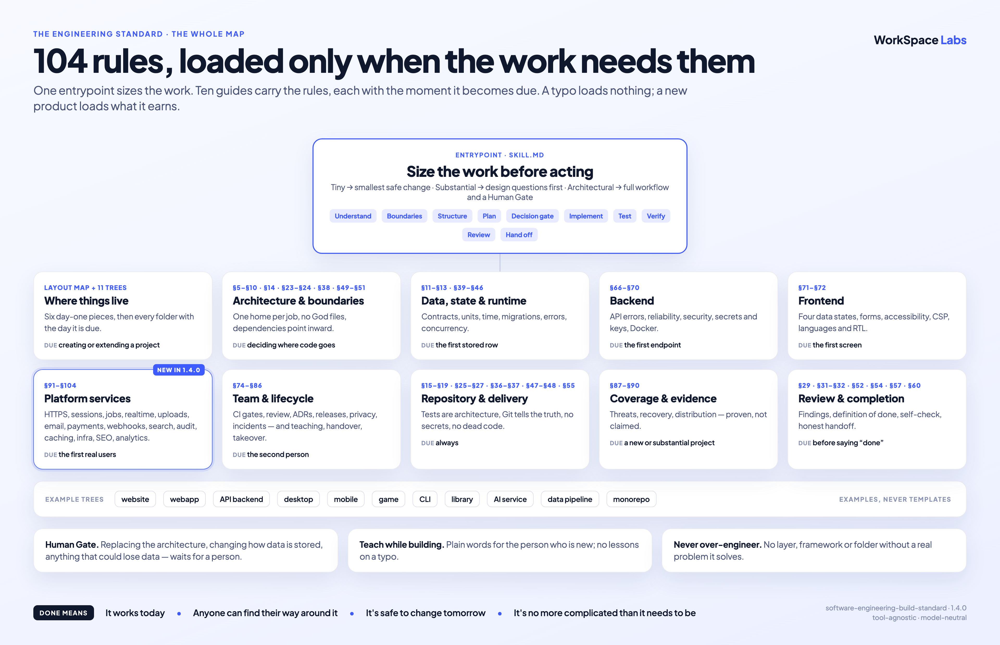

# An engineering standard for AI agents

**AI agents can build software that works today and is painful to change next month. A better prompt doesn't fix that. A standard the agent follows from the first file does.**

This is that standard, packaged as an Agent Skill. It makes structure, clear ownership, tests, documentation and Git hygiene part of the build instead of a clean-up job for later — and it scales down, so a small project stays small.

It is tool-agnostic. Nothing here depends on a particular model, CLI, or framework.

The skill is in this repo — [`skills/`](skills).

**New to building software?** Start with the [new developer guide](docs/new-developer-guide.md).

---

## In practice



*The whole standard on one page. A typo loads nothing; a new product loads only what it earns.*

---

## What it asks of an agent

- **Size the work first.** A typo gets the smallest safe change. A new project gets its requirements, a map of its parts, a data model and a test plan before the first feature.
- **Check what the project needs (§87–§90).** Reuse the project documents you have already approved and their requirement labels, so checks point back to what you asked for. Show what was proved, what does not apply and why, and what is still unfinished. The project-docs skill plans what to build; this skill builds it and checks the work.
- **Give every job one home.** Keep unrelated jobs out of one giant file. Rules about how the product works stay separate from screens and the code that saves data.
- **Think of the cases nobody mentioned (§105).** Two people booking the same slot, a refund after a cancellation, an empty basket: the agent writes each product rule down, walks its edge cases, asks you about the ones that matter and tests them.
- **Stay standing when it gets busy (§106).** Everything that can grow has a limit; at a limit the server says "too big" for an oversized upload, or "busy, try again" when requests arrive too fast or the server is full. It never crashes or loses accepted work.
- **Build the tests and the docs with the code**, not after it.
- **Build the server and screens carefully.** Rules for how programs talk to each other, keeping the server running, protecting secrets such as service keys and packaging it in containers each say when they are needed. Screens handle loading, empty results, errors, success, accessibility, security and languages when needed.
- **Build the services the product needs (§91–§104).** Secure web addresses, remembering signed-in users, separating customer accounts, work done in the background, live updates, uploads, email, payments, updates sent by other services, search, records of important actions, reusing results and handling more traffic, server setup kept as code, public pages, usage measurement and error tracking — each only when needed, using what the project's tools already provide before adding a new service.
- **Look after the project as it grows.** Review by teammates, automated checks before changes are accepted, recorded decisions, releases, privacy and maintenance each apply when needed; a tool built by one person stays small.
- **Teach while building (§84).** Explain important choices in plain words when the person is new or asks for explanations; keep tiny tasks free of lessons.
- **Don't over-engineer.** No layer, interface, framework or folder without a real problem it solves.
- **Leave the big calls to the owner.** Replacing the architecture, changing how data is stored, or anything that could lose data waits for a person.

---

## Use it

With Node.js and npm installed, one line makes it available across your projects.

macOS or Linux:

```bash
npx skills add workspace-labs/agent-engineering-standard -g
```

Windows PowerShell (use the `.cmd` launcher so PowerShell's script execution policy does
not block npm's `.ps1` wrapper):

```powershell
npx.cmd skills add workspace-labs/agent-engineering-standard -g
```

Or clone it and copy the whole skill folder by hand:

```bash
git clone https://github.com/workspace-labs/agent-engineering-standard.git
```

Choose the user skill location for your agent, following its current documentation. For
Codex, the documented user location is `~/.agents/skills/`; Claude uses `~/.claude/skills/`:

**macOS or Linux (Bash)**

```bash
skill_root="$HOME/.agents/skills"        # Codex
# skill_root="$HOME/.claude/skills"      # Claude: use this instead
```

Then copy into a new destination. This refuses an existing folder or symlink, so an update
cannot silently mix old and new reference files. Back up an existing installation before
replacing it through your normal update workflow.

```bash
skill_source="agent-engineering-standard/skills/software-engineering-build-standard"
skill_target="$skill_root/software-engineering-build-standard"
if [ -e "$skill_target" ] || [ -L "$skill_target" ]; then
  printf '%s\n' "Already exists: $skill_target. Back it up before updating." >&2
  false
else
  mkdir -p "$skill_root" && cp -R "$skill_source" "$skill_target"
fi
```

**Windows (PowerShell)**

Run from the directory containing the clone. These commands also refuse an existing
destination, including a hidden folder or link, rather than merging installations:

```powershell
$skillRoot = Join-Path $env:USERPROFILE '.agents\skills'   # Codex
# $skillRoot = Join-Path $env:USERPROFILE '.claude\skills' # Claude: use this instead
$skillSource = Join-Path $PWD.Path 'agent-engineering-standard\skills\software-engineering-build-standard'
$skillTarget = Join-Path $skillRoot 'software-engineering-build-standard'
if (Get-Item -LiteralPath $skillTarget -Force -ErrorAction SilentlyContinue) {
  throw "Already exists: $skillTarget. Back it up before updating."
}
New-Item -ItemType Directory -Path $skillRoot -Force -ErrorAction Stop | Out-Null
Copy-Item -LiteralPath $skillSource -Destination $skillTarget -Recurse -ErrorAction Stop
```

The bundled `agents/openai.yaml` supplies optional interface metadata; it is not required
for skill discovery. See [the official Codex skill documentation](https://learn.chatgpt.com/docs/build-skills)
for discovery locations and metadata.

Agents can choose it when they build, extend, restructure or review software, or you can
invoke it explicitly as `$software-engineering-build-standard`. The entry point is
[`SKILL.md`](skills/software-engineering-build-standard/SKILL.md), with supporting reference
guides and [staged examples for ten project types](skills/software-engineering-build-standard/references/trees/README.md).
The [layout map](skills/software-engineering-build-standard/references/layout-map.md) gives
each piece's *due at* trigger, so nothing is created before the product earns it. A project's
own rules, recorded decisions and the owner's instructions always come first.

## Versions

The standard uses semantic versioning: a patch fixes wording; a minor version adds rules or
guidance that stays compatible; a major version removes a rule or changes its meaning.
Rule IDs are never renumbered.

To pin a version, use the newest published tag listed on the repository's
[GitHub Releases page](https://github.com/workspace-labs/agent-engineering-standard/releases).
Replace the example tag `v1.5.0` below with that tag (`vX.Y.Z`):

```bash
git clone --branch v1.5.0 https://github.com/workspace-labs/agent-engineering-standard.git
```

## Test it

From the repository root, Python 3.9 or newer runs offline checks of the skill's metadata, links, structure and rule citations using only the standard library.

macOS or Linux:

```bash
python3 -B -m unittest discover -s tests -v
```

Windows PowerShell:

```powershell
py -3 -B -m unittest discover -s tests -v
```

See [verification details](docs/operations/verification.md) and [CI](.github/workflows/check-skill.yml).

---

## Working on this repository

See [AGENTS.md](AGENTS.md), [the package scope](docs/scope.md) and
[the architecture and source boundaries](docs/architecture/overview.md). The installable source
stays in the skill folder; no empty application src/ scaffold is required.
[Verification and publication](docs/operations/verification.md) describes offline and behavioral
checks. [CHANGELOG.md](CHANGELOG.md) records updates, while
[findings and limits](docs/risks-and-debt.md) keep audit closure separate from universal assurances.

## What it costs

- **Slower first steps.** A new project spends its opening on a map, a data model and a test plan instead of features.
- **More questions for the owner.** Big decisions wait for a person, and some of those waits will feel slow.
- **It can't rescue a bad idea.** A standard shapes how something is built, not whether it was worth building.

**Worth it when:** the software has to outlive the week, or more than one agent or person will change it.

**Not worth it when:** it's a throwaway prototype. The standard itself says to keep those minimal.

---

## The shortest version

> Never build first and organize later. Give every piece a home, a check and a note from the first file — and keep it no more complicated than the product needs.

---

<sub>by Workspace Labs · Drawn from a working system, not a thought experiment — see <a href="https://github.com/workspace-labs/workspace">a showcase of it running</a>, and the patterns beside it: <a href="https://github.com/workspace-labs/agent-builder-handoff">a builder handoff for AI agents</a>, <a href="https://github.com/workspace-labs/agent-health-checks">health checks for AI agents</a> and <a href="https://github.com/workspace-labs/agent-separation-of-duties">separation of duties for AI agents</a>.</sub>
